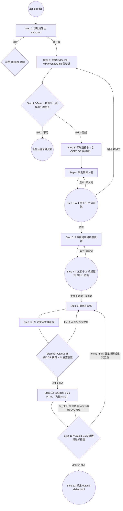

# `/topic-slides` 腦中風 LLM Wiki 離線 HTML 簡報生成流程

當使用者呼叫 `/topic-slides <主題>` 或請求依本知識庫生成 HTML 簡報時，嚴格依照下列步驟執行。

> [!CAUTION] 臨床安全與知識庫硬性原則（承襲 `AGENTS.md`）
> 1. **零幻覺**：所有劑量、時間窗、影像閾值、統計數字、收案條件與 `COR / LOE` 皆必須 100% 出自本庫 `wiki/` 內容，嚴禁憑記憶補充外部數據。
> 2. **唯讀原則**：本流程嚴格唯讀 `index.md` 與 `wiki/`，**不得修改 `wiki/` 任何筆記，亦不可觸碰 `raw/`**。
> 3. **版本與分歧顯性化**：不得將 `status: superseded` 舊指引當作現行建議；若主題涉及本庫已記錄之指引分歧（如 `AHA/ASA` vs `台灣腦中風學會`），必須於簡報中明確並列呈現。
> 4. **臨床免責聲明**：每份簡報之封面頁或結尾頁必須附簡短免責聲明（僅供醫療衛教／學術整理參考，不得替代床邊臨床判斷與院內 SOP）。
> 5. **嚴禁跳關**：每完成一步必須更新 `state.json`；每逢【腳本關卡】必須實際執行對應 Python 腳本並依 Exit Code 路由，不可口頭替代。

---

## 工作流程總覽



腳本路徑（位於本 Skill 目錄下）：
- [gate1_coverage.py](./scripts/gate1_coverage.py)
- [gate2_fidelity.py](./scripts/gate2_fidelity.py)
- [gate3_render.py](./scripts/gate3_render.py)
- Input 範例模板：[input-template.md](./references/input-template.md)

---

## Step 0：初始化與中斷續跑（State 管理）

1. 將 `<主題>` 轉為小寫英文 `kebab-case` slug（例如 `ais-ivt-thrombolysis`、`ich-acute-bp`），建立工作目錄 `.tmp/topic-slides/<slug>/`。
2. 解析使用者輸入中的簡報設定（若未指定則套用下列預設值）：
   - `audience`：預設 `"不熟悉此主題的初學者（避免未經解釋的專業術語，必要時用白話或類比輔助；但臨床數據與建議等級仍須忠實於證據卡）"`（可依使用者輸入覆寫為住院醫師／專科醫師／護理師等模式）
   - `goal`：預設 `"教學型簡報，建立概念、因果邏輯與循序漸進的學習路徑"`
   - `target_pages`：預設 `"8-10"`
   - `visual_preference`：預設 `"多利用流程圖、對照表或步驟拆解，幫助受眾建立心理模型"`
   - `must_include`：擷取使用者指定之必含範圍（選填）
3. 檢查 `.tmp/topic-slides/<slug>/state.json` 是否存在：
   - **若存在且使用者未指定「重來」**：讀取 `current_step` 與既有產物路徑，簡報目前進度並直接從 `current_step` 接續。
   - **若不存在（或使用者要求重來）**：初始化 `state.json`：
     ```json
     {
       "topic": "<主題>",
       "slug": "<slug>",
       "audience": "<解析後受眾>",
       "goal": "<解析後簡報類型與目標>",
       "target_pages": "8-10",
       "visual_preference": "<解析後視覺偏好>",
       "must_include": [],
       "current_step": "step_1",
       "completed_steps": [],
       "retry_counts": {"fidelity": 0, "render_html": 0, "render_draft": 0},
       "css_tweaked_pages": [],
       "artifacts": {}
     }
     ```

---

## Step 1：檢索本腦中風 Obsidian Wiki（AI 節點）

1. **從正確索引入口出發**：
   - 先讀取根目錄 `index.md` 與 `wiki/overview.md`，鎖定與 `<主題>` 最相關的 `wiki/topics/*.md`、`wiki/interventions/*.md` 與 `wiki/comparisons/*.md`。
   - 再沿著這些頁面內的 `[[wikilinks]]` 展開二層關聯檔案（對應的 `wiki/guidelines/*.md`、`wiki/trials/*.md` 或鄰近主題頁）。
   - 若為人工退回「補檢索」，將使用者指定的新關鍵字納入檢索。
2. **版本過濾與節錄原則**：
   - 讀取每篇 `.md` 的 YAML frontmatter；若發現 `status: superseded`，**除非用於刻意比較版本演變（需加標 `"historical_context": true`），否則不納入現行處置依據**。
   - 針對 `topics/`、`interventions/`、`comparisons/` 可全文摘錄；針對超過 150 行的大型 `guidelines/`（如 `aha-asa-ais-2026.md`、`aha-asa-ich-2022.md`、`aha-asa-sah-2023.md`），**僅節錄與主題相關的章節並記錄 `section_range`**，避免上下文膨脹。
3. **本庫出處擷取規範**：
   - 本庫出處位於 frontmatter（`guidelines_cited`、`organization`、`year`、`source_file`）與**內文行內引註**（如 `[[aha-asa-ais-2026|AHA/ASA AIS (2026)]] Sec 4.6`）。務必完整整理至 `citations` 陣列（格式如 `"AHA/ASA AIS (2026) Sec 4.6"`、`"TSGS IVT (2025) Ch 3"`）。
4. 輸出至 `.tmp/topic-slides/<slug>/01_retrieved.json`：
   ```json
   {
     "topic": "主題名稱",
     "required_keywords": ["IVT|靜脈溶栓|血栓溶解", "時間窗|4.5"],
     "docs": [
       {
         "id": "doc_01",
         "path": "wiki/topics/ais-ivt-thrombolysis.md",
         "title": "急性缺血性中風靜脈溶栓治療（AIS IVT）",
         "status": "active",
         "section_range": "全文",
         "citations": ["AHA/ASA AIS (2026) Sec 4.6", "TSGS IVT (2025)"],
         "content": "完整或相關章節摘錄內容"
       }
     ]
   }
   ```
   - `required_keywords` 支援以 `|` 分隔同義詞（例如 `"EVT|機械取栓|動脈取栓"`），任一命中即算覆蓋。
5. 更新 `state.json`：`current_step = "step_2"`，記錄 `artifacts.retrieved`。

---

## Step 2：覆蓋率與實檔出處關卡（Gate 1 腳本）

執行指令：
```bash
python3 .agents/skills/topic-slides/scripts/gate1_coverage.py .tmp/topic-slides/<slug>/01_retrieved.json
```

- **Exit Code 0**：更新 `state.json`（`current_step = "step_3"`），進入 Step 3。
- **Exit Code 1（不足或檔案異常 → 立即中止）**：停止流程，向使用者明確列出缺漏（篇數、有效字數、缺少關鍵字、不存在檔案、`superseded` 舊指引警示或缺少出處的檔案），待補齊 Wiki 或調整主題後再以 `/topic-slides <主題>` 續跑。

---

## Step 3：萃取原子化證據卡（AI 節點）

1. 針對 `01_retrieved.json` 的每篇 `doc` 獨立萃取原子化事實、精確數據、時間窗、劑量、納入／排除條件、證據等級（`COR / LOE`）、流程步驟與跨指引分歧，**嚴禁跨篇混雜數據**。
   - 當 `docs` 數量 `≤ 4` 篇時，由主 Agent 逐篇獨立萃取即可；當 `≥ 5` 篇時，可透過 `research` subagent 平行萃取後彙整。
2. 輸出至 `.tmp/topic-slides/<slug>/02_evidence_cards.json`：
   ```json
   [
     {
       "id": "E1",
       "source_id": "doc_01",
       "citation": "AHA/ASA AIS (2026) Sec 4.6",
       "cor_loe": "COR 1, LOE A",
       "is_conflict": false,
       "claim": "發病 0–4.5 小時內具失能症狀之 AIS，Tenecteplase 0.25 mg/kg（max 25 mg）與 Alteplase 0.9 mg/kg（max 90 mg）並列首選靜脈溶栓藥物。",
       "quote": "0–4.5h 同時推薦 Tenecteplase 0.25 mg/kg（max 25 mg）或 Alteplase 0.9 mg/kg（max 90 mg）（COR 1, LOE A）"
     }
   ]
   ```
   - 若該證據屬於跨指引分歧（如 AHA/ASA vs 台灣指引）或重大禁忌紅線（`COR 3: Harm`），務必設 `"is_conflict": true` 並同時記錄各方立場。
3. 更新 `state.json`：`current_step = "step_4"`，記錄 `artifacts.evidence_cards`。

---

## Step 4：大綱規劃（AI 節點）

1. 僅依據 `02_evidence_cards.json` 與 `state.json` 中的受眾／目標規劃敘事架構，**不可引入未出現在證據卡的外部知識**。
2. 若證據卡存在 `is_conflict: true` 之指引分歧，必須安排對應頁面或對照表顯性呈現，不得隱去一方說法。
3. 每頁須標註：`page`（整數）、`type`（`cover` / `section` / `content` / `summary`）、`title`、`key_points`、`visual_hint`（如 `flowchart`、`comparison_table`、`timeline`、`decision_cards`、`bar_chart`、`bullets`）、`evidence_ids`。
4. 輸出至 `.tmp/topic-slides/<slug>/03_outline.json`，更新 `state.json`：`current_step = "step_5"`。

---

## Step 5：【人工關卡 1】大綱審視（暫停點）

向使用者展示 `03_outline.json` 的 Markdown 表格預覽（頁碼、類型、標題、核心重點、建議視覺類型、引用證據 ID，以及是否有跨指引分歧頁），並使用 `ask_question`（或直接暫停）等待使用者指令：
- **核准**：更新 `state.json`（`current_step = "step_6"`），進入 Step 6。
- **退回 → 修大綱**：依回饋回到 **Step 4** 修改，再回到 Step 5。
- **退回 → 補檢索**：依補充關鍵字回到 **Step 1** 重跑。

---

## Step 6：視覺範例預渲染（AI 節點）

1. 從 `03_outline.json` 挑選 2 頁代表頁：**封面頁 ＋ 1 頁含流程圖、比較表或數據圖表的核心內容頁**。
2. 設計 **3 套風格鮮明且符合醫療教學專業感的視覺方案**（例如：方案 A 臨床清爽藍白、方案 B 深海高對比資訊圖表、方案 C 暖紙編輯雜誌風），並明確定義各自適合的每頁字數密度上限。
3. 產出單一完全離線可開的比較頁 `.tmp/topic-slides/<slug>/04_theme_previews.html`（禁止外部 CDN），頂部提供切換按鈕一鍵比較方案 1 / 2 / 3 的實際 16:9 排版、對照表與內嵌 SVG 樣式。
4. 更新 `state.json`：`current_step = "step_7"`，記錄 `artifacts.theme_previews`。

---

## Step 7：【人工關卡 2】視覺元素確認（暫停點）

請使用者在瀏覽器開啟 `.tmp/topic-slides/<slug>/04_theme_previews.html`（附上 clickable `file://` 連結；若使用者希望也可透過 `/browser` 檢視），並暫停等待指令：
- **選定方案（3 選 1）或混合微調**（例如：「選方案 2，但主色改深藍、字體加大」）：
  - 將定案的配色、字體堆疊、字級、留白規範與每頁建議字數上限寫入 `.tmp/topic-slides/<slug>/04_design_tokens.json`。
  - 更新 `state.json`（`current_step = "step_8"`），進入 Step 8。
- **都不滿意**：記錄偏好方向，退回 **Step 6** 重新產出 3 款預覽。

---

## Step 8：逐頁稿撰寫（AI 節點）

1. **首次執行**：依據 `03_outline.json`、`02_evidence_cards.json`、`04_design_tokens.json` 與 `state.json` 之受眾風格撰寫所有頁面至 `.tmp/topic-slides/<slug>/05_slides_draft.json`：
   ```json
   [
     {
       "page": 2,
       "type": "content",
       "title": "本頁標題",
       "layout": "comparison_table",
       "bullets": ["精簡重點（面向初學者時可白話解說，但數據與 COR/LOE 須與證據卡一致）"],
       "visual_data": {
         "type": "table",
         "headers": ["項目", "方案 A", "方案 B"],
         "rows": [["...", "...", "..."]]
       },
       "citation_footer": "AHA/ASA AIS (2026) Sec 4.6; TSGS IVT (2025)",
       "evidence_ids": ["E1", "E2"]
     }
   ]
   ```
   - 封面或末頁須納入簡短臨床免責聲明（`disclaimer` 或頁尾文字）。
   - 若受眾為初學者：首次出現英文醫學縮寫（如 `IVT`、`EVT`、`NIHSS`、`DCI`）應附中文與簡短白話說明，但**不可為了白話而篡改精確數字、時間窗或證據強度**。
2. **退回重跑時**：僅針對上一道關卡回報的 `failed_pages` 局部修正（修正語意推論、補齊引用或 `citation_footer`、精簡文字或拆頁），**嚴禁改動已通過之頁面**。
3. 更新 `state.json`：`current_step = "step_9"`。

---

## Step 9：忠實度檢查（AI 語意審查 ＋ Gate 2 腳本）

1. **Step 9a（AI 語意審查）**：逐頁比對 `05_slides_draft.json`（涵蓋所有 `content` 與 `summary` 頁）與對應 `02_evidence_cards.json`，嚴格檢查：
   - 語意過度推論（如將「相關性」寫成「因果」、把 `COR 2a/2b` 寫成「必須／唯一標準」）
   - 遺漏關鍵臨床前提（如時間窗、NIHSS/ASPECTS 門檻、劑量上限、排除條件）
   - 抹平跨指引分歧或遺漏 `COR 3: Harm` 紅線
   - 輸出至 `.tmp/topic-slides/<slug>/05b_semantic_audit.json`：
     ```json
     [
       {"page": 2, "passed": true, "issues": []}
     ]
     ```
2. **Step 9b（執行 Gate 2 腳本）**：
   ```bash
   python3 .agents/skills/topic-slides/scripts/gate2_fidelity.py \
     .tmp/topic-slides/<slug>/02_evidence_cards.json \
     .tmp/topic-slides/<slug>/05_slides_draft.json \
     .tmp/topic-slides/<slug>/05b_semantic_audit.json
   ```
   - **Exit Code 0**：更新 `state.json`（`current_step = "step_10"`），進入 Step 10。
   - **Exit Code 1（退回 → 只修失敗頁）**：
     - 若 `retry_counts.fidelity < 3`：`retry_counts.fidelity += 1`，僅針對 `failed_pages` 回到 **Step 8** 修正。
     - 若已達上限（3 次）：暫停並呈報衝突頁碼請人工裁決。

---

## Step 10：渲染完全離線 HTML（AI 節點）

1. 依據 `05_slides_draft.json` 與 `04_design_tokens.json` 產出單檔 HTML 簡報：`.tmp/topic-slides/<slug>/06_presentation.html`。
2. **強制技術規範（確保 Gate 3 精準量測與 100% 離線）**：
   - **完全離線可開**：嚴禁任何外部 `http://`、`https://` 或 `//` 資源（含 `<script>`、`<link>`、``、CSS `@import`、`url(...)`）；使用跨平台系統字體堆疊（如 `"PingFang TC", "Noto Sans TC", "Microsoft JhengHei", -apple-system, sans-serif`）。
   - **圖表與流程圖**：使用**內嵌純 `<svg>`**（含明確 `viewBox` 與寬高）或純 HTML/CSS 繪製，不依賴外部 JS 套件。
   - **可測性與翻頁契約**：
     - 每頁以 `<section class="slide" data-page="<頁碼>">` 包裹，固定 16:9 尺寸（`width: 1280px; height: 720px; box-sizing: border-box; overflow: hidden;`）。
     - **以 `.slide.active` 控制顯示**（例如 `.slide { display: none; }` 搭配 `.slide.active { display: flex; flex-direction: column; }` 或 `display: grid;`），讓瀏覽器與 Gate 3 能以真實 `flex/grid` 佈局量測每頁。
     - 裝飾性背景元素若故意超出邊界，須標註 `aria-hidden="true"` 或 `data-decorative="true"`，以免干擾元素邊界檢查。
     - 內建鍵盤左右鍵／空白鍵／點擊翻頁、頁碼指示器與全螢幕／縮放適配（視窗縮放用外層容器 `transform: scale(...)`，不改動 `.slide` 本身 `1280×720` 實尺寸）。
3. **若為 Gate 3 `fix_html` 退回重跑**：
   - 依報告修正外部資源、JS 錯誤、空白 SVG、破圖，或針對 `css_tweak_pages` 微調該頁 `padding`／行高／字級（不刪減文字），並將微調過的頁碼加入 `state.json` 的 `css_tweaked_pages`。
4. 更新 `state.json`：`current_step = "step_11"`。

---

## Step 11：渲染與離線檢查（Gate 3 腳本）

執行指令：
```bash
python3 .agents/skills/topic-slides/scripts/gate3_render.py \
  .tmp/topic-slides/<slug>/06_presentation.html \
  --state .tmp/topic-slides/<slug>/state.json
```

- **Exit Code 0（`routing_action == "deliver"`）**：更新 `state.json`（`current_step = "step_12"`），進入 Step 12。
- **Exit Code 1**：依 `routing_action` 分流：
  - **`"fix_html"`**（外部 CDN 違規、JS 錯誤、空白 SVG、破圖，或微幅爆版 `≤ 40px` 且尚未微調過）：
    - 若 `retry_counts.render_html < 3`：`retry_counts.render_html += 1`，回到 **Step 10** 局部修復 HTML/CSS/SVG（**不必退回 Step 8**）。
    - 若達上限則呈報殘餘問題請人工裁決。
  - **`"revise_draft"`**（嚴重爆版 `> 40px`、水平溢出或 CSS 微調後仍溢出）：
    - 若 `retry_counts.render_draft < 3`：`retry_counts.render_draft += 1`，回到 **Step 8** 精簡該失敗頁文字或拆頁，並重跑 Step 9–11。
    - 若達上限：進入 Step 12 交件，並在結案報告中顯著標註仍有排版警告的頁碼。

---

## Step 12：交件（自動完成）

1. 複製 `.tmp/topic-slides/<slug>/06_presentation.html` 至 `output/<slug>-slides.html`（自動建立 `output/` 目錄）。
2. 更新 `state.json`：`current_step = "done"`，記錄 `artifacts.final_html = "output/<slug>-slides.html"`。
3. 向使用者回報最終檔案之 clickable `file://` 連結、總頁數、定案視覺風格、引用指引清單，以及三道關卡通過摘要。
