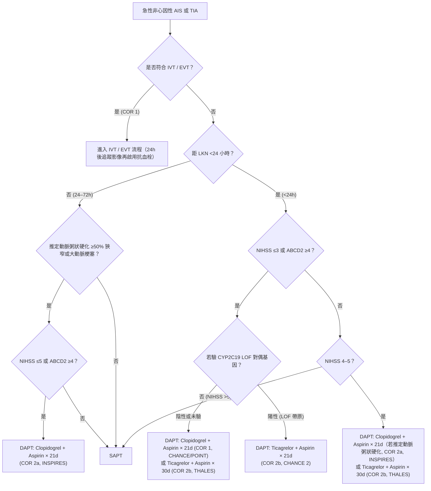

# 急性缺血性中風抗血小板與短期 DAPT 處置

> [!tip] 臨床速查結論（Bottom Line）
> - **一般非心因性 AIS**：發病 **48 小時內**給予 **Aspirin**（COR 1, LOE A），且抗血小板優於口服抗凝劑（COR 1, LOE A，[[aha-asa-ais-2026|AHA/ASA AIS (2026)]] Sec 4.8）。
> - **輕型非心因性 AIS / 高風險 TIA 首選短期 DAPT（未接受 IVT）**：
>   - `≤24h`、`NIHSS ≤3` 或 `TIA ABCD2 ≥4`：**Clopidogrel（300 或 600 mg load → 75 mg/d）＋ Aspirin × 21 天**，後續改 SAPT（**COR 1, LOE A**；CHANCE / POINT；勿超過 90 天）。
>   - `推定動脈粥狀硬化（≥50% 狹窄或大動脈梗塞）`、`24–72h`（NIHSS ≤5 / ABCD2 ≥4）或 `≤24h`（NIHSS 4–5）：**Clopidogrel（300 mg load）＋ Aspirin × 21 天**（**COR 2a, LOE B-R**；INSPIRES）。
>   - `<24h`、`NIHSS ≤5` 或 `ABCD2 ≥6 / ≥50% 狹窄`：可考慮 **Ticagrelor（180 mg load → 90 mg BID）＋ Aspirin × 30 天**（COR 2b，THALES）；若帶 **CYP2C19 LOF 對偶基因**（NIHSS ≤3 / ABCD2 ≥4, ≤24h），可考慮 **Ticagrelor ＋ Aspirin × 21 天**（COR 2b，CHANCE 2）。
> - **五大禁止紅線（COR 3）**：禁止以 Aspirin 取代 IVT/EVT、禁止 IVT 同時或 90 分鐘內給 IV Aspirin（ARTIS）、禁止 IV Abciximab（AbESTT-II）、禁止三聯抗血小板（TARDIS）、禁止 IVT 併用 Eptifibatide 或 Argatroban（MOST / ARAIS）；亦**不建議無顱內血栓之 48h 內緊急 CEA**（Sec 4.12，COR 3: No Benefit）。

---

## 1. 輕型非心因性 AIS／高風險 TIA 短期 DAPT 決策流程（改繪自 AHA/ASA 2026 Figure 4, e379）

---

## 2. 短期 DAPT 五大關鍵試驗劑量與 NNT 對照（AHA/ASA 2026 Table 9, e380）

| 試驗 | 收案對象 | 用藥與療程 | 啟動窗（LKN） | NNT | 核心療效與出血數據（摘自 Sec 4.8） |
| :--- | :--- | :--- | :--- | :--- | :--- |
| **CHANCE**（N=5170） | AIS（NIHSS ≤3）或 TIA（ABCD2 ≥4） | Clopidogrel `300 mg` load → `75 mg/d` ＋ Aspirin `75 mg/d` × **21d**，後改 Clopidogrel | ≤24 h | **28** | 90d 復發 HR 0.68（95% CI 0.57–0.81, P<0.001）；中重度出血 0.3% vs 0.3%（P=0.73） |
| **POINT**（N=4881） | AIS（NIHSS ≤3）或 TIA（ABCD2 ≥4） | Clopidogrel `600 mg` load → `75 mg/d` ＋ Aspirin `50–325 mg/d` × **90d** | ≤12 h | **67** | 90d 缺血事件 5.0% vs 6.5%（HR 0.75, P=0.02）；大出血 0.9% vs 0.4%（HR 2.32, P=0.02）；事後分析顯示效益集中前 21d（0–21d HR 0.65 vs 22–90d HR 1.38） |
| **THALES**（N=11,016） | AIS（NIHSS ≤5）或 TIA（ABCD2 ≥6 或 ≥50% 症狀性狹窄） | Ticagrelor `180 mg` load → `90 mg BID` ＋ Aspirin `300–325 mg` load → `75–100 mg/d` × **30d** | ≤24 h | **91** | 30d 中風/死亡 5.5% vs 6.6%（HR 0.83, P=0.02）；嚴重出血 0.5% vs 0.1%（P=0.001） |
| **INSPIRES**（N=6100） | AIS（NIHSS ≤5）或 TIA（ABCD2 ≥4），**推定動脈粥狀硬化** | Clopidogrel `300 mg` load → `75 mg/d` ＋ Aspirin `100–300 mg` load → `100 mg/d` × **21d**，後改 Clopidogrel | 24–72 h（NIHSS 4–5 為 ≤24h） | **53** | 90d 復發 7.3% vs 9.2%（HR 0.79, P=0.008）；中重度出血 0.9% vs 0.4%（HR 2.08, P=0.03） |
| **CHANCE 2**（N=6412） | AIS（NIHSS ≤3）或 TIA（ABCD2 ≥4）＋ **CYP2C19 LOF** | Ticagrelor `180 mg` load → `90 mg BID` ＋ Aspirin `75–300 mg` load → `75 mg/d` × **21d**，後改 Ticagrelor | ≤24 h | **63** | 90d 復發 6.0% vs 7.6%（HR 0.77, P=0.008）；總出血 5.3% vs 2.5%，中重度出血均 0.3% |

---

## 3. 特殊情境、禁忌症與緊急頸動脈處置（Sec 4.8, 4.9, 4.12）

| 臨床情境 | 建議內容 | COR / LOE | 出處與依據 |
| :--- | :--- | :--- | :--- |
| **IVT 後 24 小時內抗血小板** | **AHA 2026**：風險不確定，僅於不給具重大風險共病時考慮（`COR 2b, LOE B-NR`）。**台灣 TSGS 2025**：(1) 24h 內發生早期神經學惡化（END）且排除出血與 LVO，可考慮 **IV Tirofiban**（`COR IIb, LOE B-NR`）；(2) 橋接 EVT 遇**動脈狹窄再阻塞或急放支架**，可考慮早期抗血小板（**`COR IIa, LOE B-NR`**）。 | `AHA 2b` / `TSGS IIa–IIb` | [[aha-asa-ais-2026\|AHA/ASA AIS (2026)]] Sec 4.8；[[tsgs-ivt-2025\|TSGS IVT (2025)]] Sec 9.4 (p.25–29) |
| **顱外頸／椎動脈剝離** | 抗血小板**或**抗凝治療至少 **3 個月**皆合理 | `COR 2a, LOE B-R` | CADISS、TREAT-CAD 合併（N=444） |
| **服 Aspirin 期間突破性中風** | 加量或更換另一種 SAPT 療效尚未確立 | `COR 2b, LOE B-NR` | 缺高品質 RCT（Sec 4.8, e378, e381） |
| **單用 Ticagrelor 優於 Aspirin** | 不建議（SOCRATES 未達優效 P=0.07；但 Aspirin 禁忌者可替代） | `COR 3: No Benefit, LOE B-R` | SOCRATES（Sec 4.8, e378, e381–e382） |
| **IV Tirofiban（非 EVT 術前）** | 療效尚未確立（TREND 降早期惡化但 90d mRS 無異）；**EVT 術前用則屬 COR 3: No Benefit** | `COR 2b, LOE B-R`（術前 `COR 3`） | TREND；RESCUE-BT（Sec 4.7.4 & 4.8） |
| **一般未區分 AIS 48h 內早期抗凝** | **不建議**（未降失能/死亡 OR 0.98，顯著增 sICH OR 2.47 與顱外出血 OR 2.99） | `COR 3: No Benefit, LOE A` | 28 試驗統合（N=24,025，Sec 4.9） |
| **無顱內血栓之高度頸動脈狹窄／阻塞（≤48h 緊急 CEA）** | **48 小時內緊急 CEA 無益**（較第 3–14 天增加 30 天中風 OR 1.57 與死亡 OR 5.19，由舊版調降） | `COR 3: No Benefit, LOE B-NR` | 新統合分析（N=232,952，Sec 4.12, e388–e389） |

> [!danger] 急性抗血栓絕對禁止項目（COR 3: Harm / No Benefit）
> - **禁止以 Aspirin 取代 IVT 或 EVT**（COR 3: Harm, LOE B-R）
> - **禁止於 IVT 同時或啟動後 90 分鐘內給予 IV Aspirin**（ARTIS：sICH 4.3% vs 1.6%, RR 2.78；COR 3: Harm, LOE B-R）
> - **禁止給予 IV Abciximab**（AbESTT-II：sICH/致命 ICH 5.5% vs 0.5%；COR 3: Harm, LOE B-R）
> - **禁止三聯抗血小板（Aspirin + Clopidogrel + Dipyridamole）**（TARDIS：出血 a-cOR 2.54；COR 3: Harm, LOE B-R）
> - **禁止 IVT 併用 Eptifibatide 或 Argatroban**（MOST 顯示 90d 死亡率 12%/24% vs 8%；ARAIS 陰性；COR 3: No Benefit）

---

## 4. 各大指引建議對照（AHA/ASA vs ESO vs 台灣腦中風學會）

| 比較面向 | AHA/ASA 指引（2026） | ESO 指引 | 台灣腦中風學會指引（TSGS） | 備註 |
| :--- | :--- | :--- | :--- | :--- |
| **0–24h 輕型 AIS / TIA DAPT** | Clopidogrel + Aspirin × 21d（COR 1, LOE A） | `[庫內文獻尚未收錄]` | `[庫內文獻尚未收錄]` | — |
| **24–72h 動脈粥狀硬化 DAPT** | INSPIRES：Clopidogrel + Aspirin × 21d（COR 2a, LOE B-R） | `[庫內文獻尚未收錄]` | `[庫內文獻尚未收錄]` | — |
| **≤48h 緊急 CEA（無顱內血栓）** | COR 3: No Benefit（調降） | `[庫內文獻尚未收錄]` | `[庫內文獻尚未收錄]` | — |

---

## 5. 相關頁面
- **心房顫動抗凝時機**：[[sp-af-anticoagulation-timing|心房顫動中風後抗凝劑啟用時機]]
- **再灌流主題**：[[ais-ivt-thrombolysis|急性缺血性中風靜脈溶栓治療（AIS IVT）]]、[[ais-evt-thrombectomy|急性缺血性中風血管內機械取栓（AIS EVT）]]
- **核心指引**：[[aha-asa-ais-2026|AHA/ASA AIS 臨床指引 (2026)]]
- **上游導覽**：[[overview|腦中風臨床處置總覽]]
