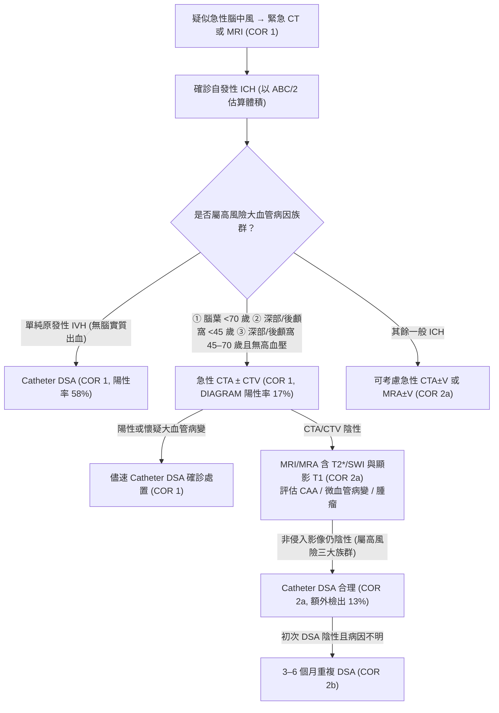

# 自發性腦出血急性診斷、血壓控制與止血處置

> [!tip] 臨床速查結論（Bottom Line，[[aha-asa-ich-2022|AHA/ASA ICH (2022)]]）
> - **急性降壓時程與目標（Sec 5.1）**：輕中度 ICH（GCS ≥5、非大片出血）入院 SBP `150–220 mm Hg` → **發病 2 小時內啟動、1 小時內達標**（`COR 2a`），平滑低變異滴定至**目標 `140 mm Hg`（維持 `130–150 mm Hg`）**（`COR 2b, B-R`）。
> - **降壓紅旗（`COR 3: Harm`）**：輕中度 ICH 入院 SBP >150 mm Hg，**急性降 SBP `<130 mm Hg` 具潛在危害，應避免**（ATACH-2 顯著增腎臟與嚴重不良事件）；並避免靜脈血管擴張劑（如 Nitroglycerin）與首小時驟降 >60 mm Hg。大面積／重度 ICH 須兼顧 **`CPP 60 至 ≥70 mm Hg`**。
> - **抗血小板相關 ICH 紅旗（`COR 3: Harm`）**：服用 Aspirin 且**不需緊急手術者禁用血小板輸注**（PATCH RCT 惡化 3 個月 mRS）；僅緊急開顱手術可考慮（`COR 2b`）；**Ticagrelor 無法被血小板輸注反轉**。
> - **抗凝劑相關 ICH**：**立即停藥並儘速反轉（絕不等 INR 報告，`COR 1`）**，完整方案見 [[ich-anticoagulation-reversal|自發性腦出血抗凝劑反轉處置]] 與 [[four-factor-pcc|4-Factor PCC]]。
> - **血腫擴大（HE）追蹤與病因檢核（Sec 4）**：穩定病患於 **6h 與 24h 追蹤頭部 CT**（`COR 2a`）；**腦葉 <70 歲、深部/後顱窩 <45 歲、或 45–70 歲無高血壓史**必作急性 **CTA±V（`COR 1`）**；**單純 IVH** 直接做 **DSA（`COR 1`）**。

---

## 1. 急性血壓控制決策表（Sec 5.1, e297–e300）

| 臨床情境與條件 | 目標血壓與執行原則 | COR / LOE | 關鍵試驗與安全警語 |
| :--- | :--- | :--- | :--- |
| **降壓品質與藥物選擇** | 連續、平滑且穩定滴定，避免高峰與大幅 SBP 變異度 | `COR 2a, LOE B-NR` | 優先短效易滴定 IV 藥物（如 Nicardipine）；**避免靜脈血管擴張劑**（RIGHT-2 顯示經皮 Nitroglycerin 預後差且血腫/水腫變大） |
| **降壓時程** | 決定降壓時，**發病 2 小時內啟動**、**1 小時內達標** | `COR 2a, LOE C-LD` | ATACH-2 <2h 亞組降 HE 並改善 90d 預後；*警語*：首小時驟降 >60 mm Hg（或 40–60 mm Hg）與不良預後相關，最大降幅 ≥90 mm Hg 顯著增 AKI |
| **輕中度 ICH（GCS ≥5）、SBP 150–220 mm Hg** | 急性降至**目標 `140 mm Hg`**（維持 **`130–150 mm Hg`**） | `COR 2b, LOE B-R` | **INTERACT2**（目標 140、`<130` 停降，實際最低均 150）；**ATACH-2**（110–139 vs 140–179 中性）；16-RCT 統合降 HE 但功能預後中性 |
| **大面積／重度 ICH 或需減壓手術** | 積極降壓安全性與療效尚未確立（如 GCS <13、NIHSS ≥10、體積 ≥30 mL、合併 IVH） | `COR 2b, LOE C-LD` | 有 ICP 監測或 EVD 時，降壓應兼顧維持 **`CPP 60 至 ≥70 mm Hg`** |
| **輕中度 ICH、急降 SBP `<130 mm Hg`** | **潛在有害，應避免** | `COR 3: Harm, LOE B-R` | **ATACH-2**（最低均 129 mm Hg）顯著增腎臟與嚴重不良事件；入院 SBP ≥220 積極降壓反增 24h ND 與腎臟 AE |

---

## 2. 抗血小板相關出血與一般止血藥物（Sec 5.2.2–5.2.3, e304–e306）

| 藥物／處置情境 | 臨床建議內容 | COR / LOE | 關鍵試驗與限制 |
| :--- | :--- | :--- | :--- |
| **Aspirin ＋ 不需緊急手術 → 血小板輸注** | **潛在有害，不應給予** | `COR 3: Harm, LOE B-R` | **PATCH RCT（N=190）**：輸血小板使 3 個月 mRS 往較差偏移、SAE 邊緣增高，不降 HE 或死亡（唯僅 5/190 單服 ADP 抑制劑） |
| **Aspirin ＋ 需緊急神經外科開顱手術 → 血小板輸注** | 術前給予（如 1 U 分離術血小板 ± 24h 再 1 U）可能減少術後出血與死亡 | `COR 2b, LOE C-LD` | 單一中國基底核開顱 RCT（原試驗以血小板凝集檢驗排除 Aspirin 抗性）；EVD/MIS 效益未明；**Ticagrelor 無法以血小板輸注反轉** |
| **抗血小板相關 ICH → Desmopressin（DDAVP）** | DDAVP（0.3–0.4 µg/kg）單用或併用血小板輸注之療效不確定 | `COR 2b, LOE C-LD` | 僅回溯研究結果分歧，缺 RCT |
| **重組第七因子（rFVIIa）** | 不論有無 CTA Spot sign，改善功能預後療效不明確 | `COR 2b, LOE B-R` | Phase III（≤4h, 80 µg/kg）：微幅減 HE、90d mRS 無差且**顯著增動脈血栓事件** |
| **Tranexamic Acid（TXA）** | 不論有無 Spot / Black hole / Blend sign，改善功能預後尚未確立 | `COR 2b, LOE B-R` | **TICH-2 Phase III（≤8h）**：微幅降 HE、降 7 天早期死亡與 SAE（未增 VTE），但 90d 功能無差（基線 SBP <170 交互分析偏有利） |

---

## 3. 急性影像追蹤、血腫擴大徵象與病因檢核（Sec 4, e291–e297）

- **入院常規檢驗（Sec 4.1.1, Table 3, `COR 1, C-LD`）**：CBC、PT/INR/aPTT、Cr/eGFR、LFT、血糖、Cardiac Troponin 與 ECG、毒物篩檢、ESR/CRP、育齡女性驗孕；必要時查 DOAC 專測（dTT/anti-Xa，但不應延遲反轉）。
- **血腫擴大（HE）追蹤 CT（Sec 4.1.2）**：
  - 前 24h 連續 CT 評估 HE（`COR 2a, B-NR`）：HE 發生於 1h 內 26%、20h 另增 12%；6–12h 15%、12–24h 6%、**>24h 極罕見（0%）**；延遲 IVH 佔 21%。**意識穩定病患約於 6h 與 24h 追蹤 CT 即可**。
  - 低 GCS 或神經惡化（ND）隨時追蹤 CT 評估 HE、水腦、腦水腫或腦疝（`COR 2a, C-LD`）。
  - **HE 影像風險標記（`COR 2b, B-NR`）**：CTA **Spot sign**（發病 0–2h 敏感度/PPV 最高）或 NCCT 標記（hypodensities、fluid level、swirl、black hole、blend、island、satellite signs）。

---

## 4. 各大指引建議對照（AHA/ASA vs ESO vs 台灣腦中風學會）

| 比較面向 | [[aha-asa-ich-2022\|AHA/ASA ICH 指引（2022）]] | ESO 指引 | 台灣腦中風學會指引 | 備註 |
| :--- | :--- | :--- | :--- | :--- |
| **輕中度 ICH 急性血壓目標** | 2h 內啟動、1h 達標（`2a`）；目標 `140` 維持 `130–150`（`2b`）；**禁 `<130`（`COR 3: Harm`）** | `[庫內文獻尚未收錄]` | `[庫內文獻尚未收錄]` | 待收錄 ESO 與台灣 ICH 指引後補齊對照 |
| **非手術 Aspirin ICH 輸血小板** | **`COR 3: Harm, LOE B-R`**（PATCH） | `[庫內文獻尚未收錄]` | `[庫內文獻尚未收錄]` | — |
| **大血管病因影像檢核** | 腦葉 <70 / 深部 <45 / 45–70 無 HTN 必作 CTA±V（`COR 1`）；單純 IVH 直接 DSA（`COR 1`） | `[庫內文獻尚未收錄]` | `[庫內文獻尚未收錄]` | — |

---

## 5. 相關頁面
- **抗凝反轉與藥物快查**：[[ich-anticoagulation-reversal|自發性腦出血抗凝劑反轉處置]]、[[four-factor-pcc|四因子凝血酶原複合濃縮劑（4-Factor PCC）]]
- **核心指引**：[[aha-asa-ich-2022|AHA/ASA 自發性腦出血臨床指引 (2022)]]
- **跨領域對照**：[[ais-bp-glucose-supportive|急性缺血性中風血壓、血糖與生理支持處置]]（對照 AIS vs ICH 血壓目標差異）
- **上游導覽**：[[overview|腦中風臨床處置總覽]]
