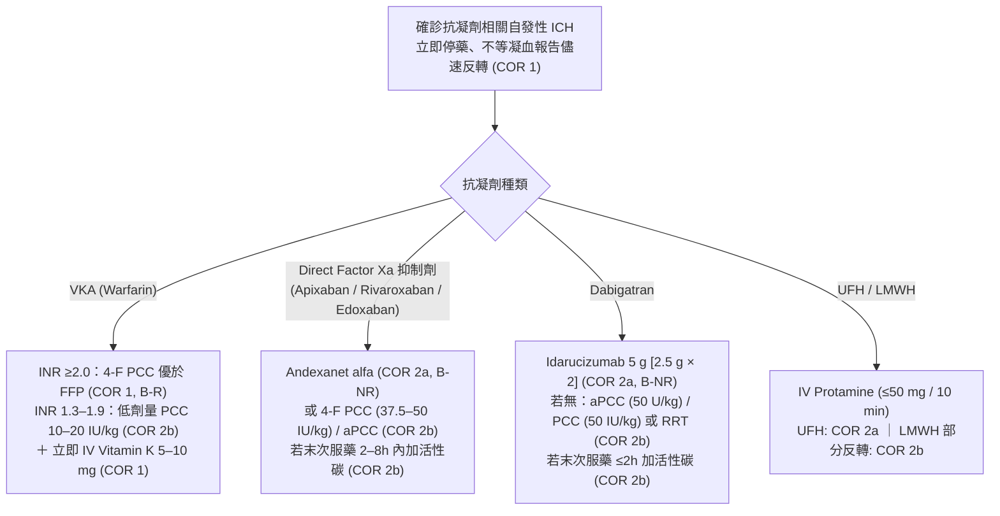

# 自發性腦出血抗凝劑反轉處置

> [!tip] 臨床速查結論（Bottom Line，[[aha-asa-ich-2022|AHA/ASA ICH (2022)]] Sec 5.2.1）
> - **時間就是大腦（`COR 1, C-LD`）**：確診抗凝劑相關 ICH 後**立即停藥並儘速反轉**，依**抗凝劑種類、末次服藥時間與腎功能**啟動處置，**絕不可等待 INR 或特殊凝血檢驗報告才反轉**（LVAD 病患反轉未見 LVAD 血栓增加）。
> - **VKA（Warfarin）**：`INR ≥2.0` 首選 **[[four-factor-pcc|4-Factor PCC]]**（25–50 IU/kg 或固定 1,500 U，優於 FFP，`COR 1, B-R`）＋**立即靜脈 Vitamin K 5–10 mg**（防 12–24h 反彈，`COR 1, C-LD`）；`INR 1.3–1.9` 可考慮低劑量 PCC `10–20 IU/kg`（`COR 2b`）。
> - **Factor Xa 抑制劑（Apixaban / Rivaroxaban / Edoxaban）**：特異反轉劑 **Andexanet alfa**（`COR 2a, B-NR`）；無該藥或考量成本時可考慮 **[[four-factor-pcc|4-F PCC]]（37.5–50 IU/kg）或 aPCC**（`COR 2b, B-NR`）。
> - **Dabigatran**：首選特異反轉劑 **Idarucizumab 5 g**（分兩次 `2.5 g` 靜推，`COR 2a, B-NR`）；無法取得時考慮 **aPCC（FEIBA 50 U/kg）／PCC（50 IU/kg）**（`COR 2b`）或 **血液透析 RRT**（`COR 2b`，防透析後濃度反彈）。
> - **近期口服 DOAC（數小時內）**：Dabigatran ≤2h、Apixaban 2–6h、Rivaroxaban ≤8h 可輔加**活性碳（Activated charcoal）**（`COR 2b, C-LD`）。
> - **肝素類**：UFH 給 **IV Protamine**（`COR 2a`）；LMWH 給 **IV Protamine** 部分反轉（`COR 2b`）——**給藥速率絕不可超過 `50 mg / 10 分鐘`**。

---

## 1. 抗凝劑反轉決策流程與方案總表（Sec 5.2.1, Figure 2, e300–e304）

| 抗凝劑類別 | 首選／主要反轉藥物與劑量 | 替代／輔助方案 | COR / LOE | 關鍵研究數據與安全警語 |
| :--- | :--- | :--- | :--- | :--- |
| **VKA（`INR ≥2.0`）** | **[[four-factor-pcc\|4-F PCC]]**（依 INR/體重 `25–50 IU/kg` 或固定 `1,500 U`）＋ **IV Vitamin K `5–10 mg`** | 若無 PCC 方用 FFP（但輸注慢、HE 較高） | `COR 1, B-R`（PCC） `COR 1, C-LD`（Vit K） | **INCH RCT（30 IU/kg vs FFP）**：3h 達 INR ≤1.2 **67% vs 9%**、24h HE **18.3% vs 27.1%**（提前終止）；未補 Vit K 易於 12–24h INR 反彈 |
| **VKA（`INR 1.3–1.9`）** | 較低劑量 **[[four-factor-pcc\|PCC]] `10–20 IU/kg`** ＋ **IV Vitamin K `5–10 mg`** | — | `COR 2b, C-LD`（PCC） `COR 1, C-LD`（Vit K） | 降低劑量以減少高劑量 PCC（>2,000–3,000 IU）相關之 VTE 風險 |
| **Direct FXa 抑制劑（Apixaban / Rivaroxaban / Edoxaban）** | **Andexanet alfa**（劑量依藥物種類與末次服藥時間分層） | **[[four-factor-pcc\|4-F PCC]]（`37.5–50 IU/kg`）** 或 **aPCC**（`COR 2b, B-NR`）；Apixaban 2–6h / Rivaroxaban ≤8h 加**活性碳**（`COR 2b`） | `COR 2a, B-NR`（Andexanet） `COR 2b, B-NR`（4-F PCC/aPCC） | Andexanet open-label ICH 亞組：12h 止血優良（HE <35%）**79%**、**VTE 10%**、死亡 15%、藥價極高；4-F PCC 觀察研究 VTE 3.3%、aPCC 5% |
| **Dabigatran** | **Idarucizumab `5 g` IV**（分兩次 `2.5 g` 靜推） | 無 Idarucizumab 時：**aPCC（FEIBA `50 U/kg`）** 或 **PCC（`50 IU/kg`）**（`COR 2b`）或 **血液透析 RRT**（`COR 2b`）；≤2h 內加**活性碳**（`COR 2b`） | `COR 2a, B-NR`（Idarucizumab） `COR 2b, C-LD`（aPCC/PCC/RRT） | Idarucizumab（53 例 ICH）：不限年齡/腎功能完全反轉，血栓 5%、5 天死亡 17%；RRT 結束後**半數發生濃度反彈** |
| **未分餾肝素（UFH）** | **IV Protamine**（分次小劑量） | — | `COR 2a, C-LD` | **速率絕不可超過 `50 mg / 10 分鐘`**（防低血壓、支氣管痙攣與過敏反應；本身具微弱抗凝作用） |
| **低分子量肝素（LMWH）** | **IV Protamine**（僅能部分反轉抗 Xa） | 內文提及 Andexanet alfa 於 16 例 Enoxaparin 亦顯著降 anti-Xa | `COR 2b, C-LD` | Anti-Xa 濃度可反映藥量但無法預測 Protamine 反應 |

---

## 2. 臨床實務注意事項與檢核
- **檢驗不可拖延反轉**：DOAC 常規凝血檢驗（PT/aPTT）不可靠，特異檢驗（dTT、anti-Xa）在多數急診無法即時取得；決策應依據**末次服藥時間與腎功能（eGFR）**迅速啟動（Sec 4.1.1, 5.2.1）。
- **搭配集束照護（Care Bundle）**：觀察研究顯示將抗凝反轉（<4h 達 INR <1.3）、急性降壓、神經外科與重症照護整合成 Care Bundle，可顯著降低 30 天死亡率與血腫擴大（e301）。
- **LVAD 特殊族群**：依據觀察性資料，配戴左心室輔助裝置（LVAD）發生 ICH 時反轉抗凝劑未見 LVAD 血栓增加（e301）。
- **反轉後何時重啟抗凝劑**：機械瓣膜/LVAD 早期重啟、非瓣膜性 AF 約 7–8 週重啟與 LAAO 決策詳見 [[ich-secondary-prevention-recovery|自發性腦出血次級預防、抗血栓重啟、復健與預後決策]]。

---

## 3. 各大指引建議對照（AHA/ASA vs ESO vs 台灣腦中風學會）

| 比較面向 | [[aha-asa-ich-2022\|AHA/ASA ICH 指引（2022）]] | ESO 指引 | 台灣腦中風學會指引 | 備註 |
| :--- | :--- | :--- | :--- | :--- |
| **VKA 反轉（INR ≥2.0）** | 4-F PCC 優於 FFP（`COR 1, B-R`）＋ IV Vit K（`COR 1`） | `[庫內文獻尚未收錄]` | `[庫內文獻尚未收錄]` | 待補 ESO 與台灣 ICH 指引 |
| **Factor Xa 抑制劑反轉** | Andexanet alfa（`COR 2a`）；4-F PCC / aPCC（`COR 2b`） | `[庫內文獻尚未收錄]` | `[庫內文獻尚未收錄]` | 實務需考量各醫院藥品可得性與成本 |
| **Dabigatran 反轉** | Idarucizumab 5 g（`COR 2a`）；無則 aPCC/PCC/RRT（`COR 2b`） | `[庫內文獻尚未收錄]` | `[庫內文獻尚未收錄]` | — |

---

## 4. 相關頁面
- **藥物快查**：[[four-factor-pcc|四因子凝血酶原複合濃縮劑（4-Factor PCC）]]
- **姊妹主題**：[[ich-acute-bp-hemostasis|自發性腦出血急性診斷、血壓控制與止血處置]]
- **核心指引**：[[aha-asa-ich-2022|AHA/ASA 自發性腦出血臨床指引 (2022)]]
- **上游導覽**：[[overview|腦中風臨床處置總覽]]
