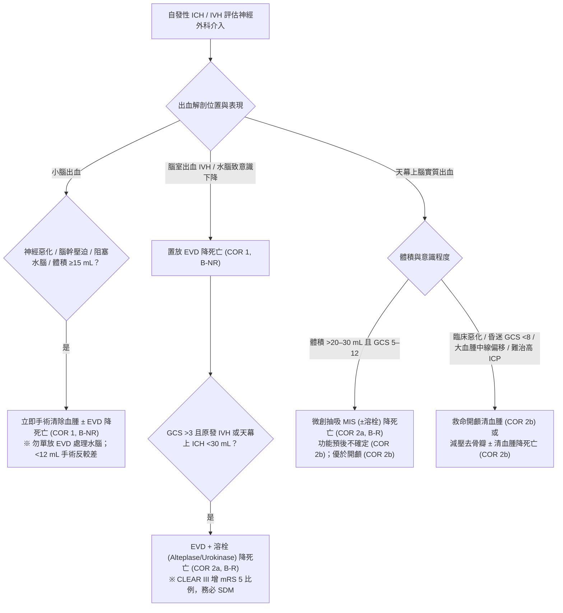

# 自發性腦出血外科手術、微創引流與顱內壓處置

> [!tip] 臨床速查結論（Bottom Line，[[aha-asa-ich-2022|AHA/ASA ICH (2022)]] Sec 5.5 & Sec 6）
> - **小腦出血（`COR 1, B-NR`）**：神經學惡化、腦幹壓迫、阻塞性水腦、或 **血腫體積 `≥15 mL`**（2022 新增門檻）→ **立即手術清除血腫（±EVD）**降低死亡率（`<12 mL` 手術反降良好預後；**合併水腦時單放 EVD 有潛在危害**）。
> - **水腦／大量 IVH 致意識下降（`COR 1, B-NR`）**：應置放 **EVD** 降低死亡率；若 **GCS >3** 且原發 IVH 或天幕上 ICH **`<30 mL`** 需 EVD，加用 **EVD 腦室內溶栓（Alteplase/Urokinase）**可進一步降死亡（`COR 2a, B-R`，CLEAR III），但功能中性且 **mRS 5 重度失能比例上升**（務必充分 SDM）。
> - **天幕上微創抽吸（MIS，MISTIE III）**：體積 **`>20–30 mL`、GCS 5–12** → 內視鏡或立體定位抽吸（±溶栓）有助**降低死亡率（`COR 2a, B-R`）**；改善功能預後仍不確定（`COR 2b`，殘餘血塊 `≤15 mL` 探索分析有利），若決定清血腫可優先選 MIS 勝過傳統開顱（`COR 2b`）。
> - **天幕上開顱（STICH）與減壓去骨瓣**：一般中重度開顱療效不確定（`COR 2b, A`），惡化者可作救命處置（`COR 2b`）；昏迷（GCS <8）、大血腫（>30 mL）併中線偏移或難治高 ICP 可考慮減壓去骨瓣（±清血腫）降死亡（`COR 2b`）。
> - **ICP 與腦水腫紅線**：**不應使用類固醇治療 ICH 高顱內壓（`COR 3: No Benefit, B-R`）**；單次推注（Bolus）滲透壓藥可暫降 ICP（`COR 2b`），但早期預防性滲透壓輸注療效未確立（且 Mannitol 恐增 HE）。

---

## 1. 解剖部位導向之外科與微創決策流程（Sec 5.5 & Sec 6, e316–e325）

---

## 2. 各類手術介入「降死亡」vs「功能預後」對照總表（Sec 6, e318–e325）

| 手術方式與適用條件 | 降低死亡率（COR / LOE） | 改善功能預後（COR / LOE） | 關鍵試驗與重要細節 |
| :--- | :--- | :--- | :--- |
| **小腦 ICH 立即手術清除（±EVD）** （神經惡化、腦幹壓迫、阻塞水腦或 **體積 `≥15 mL`**） | **`COR 1, LOE B-NR`** | 未確立（回溯研究未見明確功能改善） | IPD 統合：>15 mL 具 3m/12m 存活獲益；**`<12 mL` 手術反降低良好預後機率**；**單放 EVD 具潛在危害（尤當基底池受壓）** |
| **大量 IVH＋意識障礙 → EVD** | **`COR 1, LOE B-NR`** | `COR 2b, LOE B-NR`（未確立） | 傾向配對：GCS <13、ICH >11 mL、Graeb ≥7 存活獲益明顯 |
| **IVH → EVD＋腦室內溶栓（Alteplase / Urokinase）** （**GCS >3**、原發 IVH 或天幕上 ICH **`<30 mL`** 需 EVD） | **`COR 2a, LOE B-R`** | `COR 2b, LOE B-R`（不確定） | **CLEAR III**：降 180d 死亡、降細菌性腦室炎與 SAE、不增 sICH；但 **mRS 5 重度失能上升**（清除 >85% 血塊具探索獲益），務必充分 SDM |
| **IVH → 神經內視鏡＋EVD（±溶栓）** （天幕上 ICH `<30 mL` 需 EVD） | 未單獨給 COR | `COR 2b, LOE C-LD`（功能與減永久 shunt 不確定） | 小型 RCT 與統合具發表偏差風險 |
| **天幕上 ICH 微創抽吸（MIS，內視鏡或立體定位 ± 溶栓）** （體積 **`>20–30 mL`**、**GCS 5–12**） | **`COR 2a, LOE B-R`** | `COR 2b, LOE B-R`（對照內科不確定；對照開顱選 MIS `COR 2b, B-R`） | **MISTIE III**：7/180/365d 死亡與 30d SAE 均降、無症狀出血 32% vs 8%；1 年 mRS 0–3 中性，但**殘餘血塊 `≤15 mL`** 探索分析顯著獲益 |
| **天幕上傳統開顱清除血腫** | 惡化者作救命處置 **`COR 2b, C-LD`**；一般中重度 **`COR 2b, A`**（不確定） | `COR 2b, LOE A`（不確定） | **STICH I & II** 主要終點中性（STICH II 內科組 21% 交叉手術，74% 因惡化）；>62h 預後較差，<4h 小系列曾有安全疑慮 |
| **天幕上減壓去骨瓣（±清血腫）** （昏迷 GCS <8、大血腫 >30 mL 併中線偏移、或難治高 ICP） | **`COR 2b, LOE C-LD`** | `COR 2b, LOE C-LD`（不確定） | 系統回顧不清除血腫組死亡率 26%、良好預後 53%；是否併用血腫清除未見明確差異（SWITCH 試驗當時收案中） |

---

## 3. 顱內壓（ICP）監測、EVD 與腦水腫內科處置（Sec 5.5, e316–e318）

| 項目 | 具體建議內容 | COR / LOE | 關鍵依據與實務備註 |
| :--- | :--- | :--- | :--- |
| **水腦致意識下降 → EVD** | 應置放腦室外引流（EVD）以降低死亡率 | `COR 1, LOE B-NR` | 迅速緩解阻塞性水腦所致高 ICP；EVD 相關小出血多無顯著臨床影響 |
| **中重度 ICH/IVH → ICP 監測** | 意識下降者（如 GCS ≤8 或 9–12）可考慮 ICP 監測與處置 | `COR 2b, LOE B-NR` | 實務多參照 TBI 目標：**`ICP <22 mm Hg`**、**`CPP 50–70 mm Hg`**（大血腫/水腦降壓時留意維持 `CPP 60 至 ≥70 mm Hg`，Sec 5.1） |
| **單次推注滲透壓治療（Bolus）** | Mannitol 或高張食鹽水單次推注作為**暫時性降 ICP** 可考慮 | `COR 2b, LOE C-LD` | 2011 統合顯示等滲透壓劑量下**高張食鹽水降 ICP 優於 Mannitol**；常用 4–6 小時間隔 |
| **早期預防性滲透壓輸注** | 早期常規/持續預防性高滲透壓治療改善預後**未確立** | `COR 2b, LOE B-NR` | ERICH 分析無益；2018 統合警示早期常規 Mannitol 恐增血腫擴大 |
| **類固醇治療高顱內壓** | **不應給予類固醇（Dexamethasone）** | `COR 3: No Benefit, LOE B-R` | 3 RCT 與 Cochrane 統合皆無益，且增感染與糖尿病併發症 |

---

## 4. 各大指引建議對照（AHA/ASA vs ESO vs 台灣腦中風學會）

| 比較面向 | [[aha-asa-ich-2022\|AHA/ASA ICH 指引（2022）]] | ESO 指引 | 台灣腦中風學會指引 | 備註 |
| :--- | :--- | :--- | :--- | :--- |
| **天幕上微創抽吸（MIS）** | >20–30 mL、GCS 5–12：降死亡 `COR 2a, B-R`、功能 `COR 2b` | `[庫內文獻尚未收錄]` | `[庫內文獻尚未收錄]` | 2022 指引檢索截至 2021/11（後續新試驗待補入 `trials/`） |
| **小腦 ICH 手術體積門檻** | **體積 `≥15 mL`**（或惡化/腦幹壓迫/水腦）立即手術 `COR 1, B-NR` | `[庫內文獻尚未收錄]` | `[庫內文獻尚未收錄]` | — |
| **ICH 高顱內壓使用類固醇** | `COR 3: No Benefit, LOE B-R` | `[庫內文獻尚未收錄]` | `[庫內文獻尚未收錄]` | 與 [[inpatient-malignant-edema-seizures\|AIS 惡性腦水腫]] 同樣禁用類固醇 |

---

## 5. 相關頁面
- **姊妹主題**：[[ich-acute-bp-hemostasis|自發性腦出血急性診斷、血壓控制與止血處置]]、[[ich-anticoagulation-reversal|自發性腦出血抗凝劑反轉處置]]、[[ich-inpatient-supportive-care|自發性腦出血住院重症照護、血栓預防與癲癇處置]]
- **跨領域對照**：[[inpatient-malignant-edema-seizures|缺血性中風惡性腦水腫、減壓手術與中風後癲癇處置]]
- **核心指引**：[[aha-asa-ich-2022|AHA/ASA 自發性腦出血臨床指引 (2022)]]
- **上游導覽**：[[overview|腦中風臨床處置總覽]]
