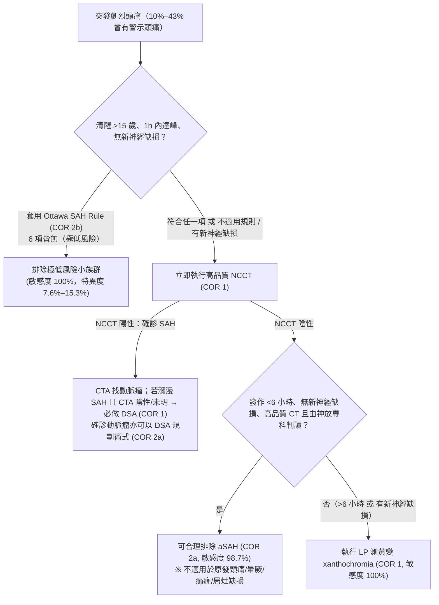

# 動脈瘤性蜘蛛膜下腔出血診斷、再出血預防與動脈瘤處置

> [!tip] 臨床速查結論（Bottom Line，[[aha-asa-sah-2023|AHA/ASA aSAH (2023)]] Sec 3–7.1）
> - **急診診斷關鍵切點（`6 小時`）**：發作 **`<6h`** 且無新神經缺損，高品質掃描儀＋神經放射專科判讀之 **NCCT** 可合理排除（`COR 2a`，敏感度 98.7%，不適用非典型表現）；發作 **`>6h`** 或有新神經缺損，NCCT 陰性必做 **LP 測黃變（`COR 1`，敏感度 100%）**；高度懷疑動脈瘤但 CTA 陰性／未明必做 **DSA（`COR 1`）**。
> - **高量能中心與分級**：初始以 **Hunt & Hess / WFNS** 分級（`COR 1`）；儘速轉送至**高量能 CSC 與專責 Neuro-ICU（`COR 1`）**；高分級（HH/WFNS 4–5，39% 良好預後）與高齡（>65 歲 42% 獨立）經 SDM 後治療皆合理（`COR 2a`）。
> - **再出血預防三大原則（Sec 6）**：
>   1. 動脈瘤未處理前以短效藥漸進控制嚴重高血壓（`>180–200 mm Hg`）、減少波動並**嚴格避免 `MAP <65 mm Hg`（`COR 1`；無單一證實 SBP 門檻）**。
>   2. 服用抗凝劑者**立即反轉（`COR 1`）**（方案參見 [[ich-anticoagulation-reversal|抗凝劑反轉處置]]）。
>   3. **禁止常規使用抗纖溶藥 TXA（`COR 3: No Benefit, A`，ULTRA RCT）**。
> - **動脈瘤處置（Sec 7）**：**24 小時內**完成（`COR 1`）、目標**完全閉塞（`COR 1`）**；**後循環**首選 Coiling（`COR 1`）；**輕症前循環**兩者皆宜時 1 年功能首選 Coiling（`COR 1, A`），長期兩者皆合理（`COR 2a`）；**合併大片腦內血腫致意識低落**緊急開顱清血腫（`COR 1`）。
> - **血管內輔助器械紅旗（`COR 3: Harm`）**：可採單純栓塞或夾閉之囊狀破裂動脈瘤**禁止使用支架或血流導向裝置（增 DAPT 與 EVD 出血）**；僅不適夾閉/單純栓塞之寬頸或血泡樣瘤方考慮（`COR 2a`，**務必先放 EVD 再啟 DAPT**）。

---

## 1. 疑似 aSAH 急診診斷流程（Sec 4, Figure 2 & Table 3, e322–e324）

- **Ottawa SAH Rule 6 大指標（Table 3，任一陽性即須檢查）**：① 年齡 `≥40 歲` ② 頸痛或頸僵硬 ③ 目擊意識喪失 ④ 用力時發作 ⑤ 雷擊瞬間達峰頭痛 ⑥ 理學檢查頸部屈曲受限。
- **CTA 侷限提醒**：CTA 對 **<3 mm 破裂動脈瘤敏感度僅 61%**（整體 97.2%），且無法直接取代 LP 排除 SAH。

---

## 2. 再出血預防與破裂動脈瘤術式決策表（Sec 3, 5, 6, 7 & 7.1）

| 臨床情境與條件 | 具體建議內容 | COR / LOE | 關鍵試驗與備註 |
| :--- | :--- | :--- | :--- |
| **動脈瘤未閉塞前血壓控制** | 頻繁監測並以短效藥物控制，減少變異；嚴重高血壓（`>180–200`）漸進降壓、**嚴避低血壓 `MAP <65 mm Hg`** | `COR 1, C-EO` | 現有證據不足以指定單一 SBP 門檻（如 <160 或 <180）；避免驟降致腦缺血 |
| **抗凝劑暴露** | 立即給予適當反轉劑預防再出血 | `COR 1, C-EO` | 參見 [[ich-anticoagulation-reversal\|抗凝劑反轉處置]] 與 [[four-factor-pcc\|4-Factor PCC]] |
| **常規抗纖溶藥（TXA）** | **不建議常規使用**（無助改善功能預後） | `COR 3: No Benefit, A` | **ULTRA RCT**：6m mRS 0–3 60% vs 64%、mRS 0–2 反較低、再出血 10% vs 14%（NS） |
| **治療時機與目標** | **優先於發病 24 小時內**完成（`COR 1, B-NR`）；追求**完全閉塞**（`COR 1, B-NR`）；急性無法完全閉塞時先部分保護破裂點＋1–3 個月延遲再治療（`COR 2a, C-EO`） | `COR 1` / `2a` | 不可拖延至 DCI 期後（>7–10 天）；由兼具血管內與開顱專長者共同評估（`COR 1`） |
| **高分級（HH/WFNS 4–5）與高齡** | 經家屬預後討論後給予動脈瘤治療皆合理（`COR 2a, B-NR`）；僅矯正可逆因子（水腦/癲癇/低鈉/低溫）後仍具不可逆腦傷且無法挽救者治療無益（`COR 3: No Benefit`） | `COR 2a` / `3` | 高分級 39% 良好預後（N=4,506）；BRAT >65 歲 42% 達 6 年獨立 |
| **後循環破裂動脈瘤（適合栓塞）** | **首選線圈栓塞（Coiling）優於開顱夾閉** | `COR 1, B-R` | Cochrane 統合死亡/依賴 **RR 0.41**；BRAT 1 年與長期均優 |
| **輕症前循環且兩術式皆適合** | **1 年功能預後首選單純栓塞（`COR 1, A`）**；就**長期功能預後兩術式皆合理（`COR 2a, B-R`）** | `COR 1, A` / `2a, B-R` | **ISAT**：1 年死亡/依賴 **RR 0.77**，5 年無顯著差（RR 0.88）；BRAT 3/6 年無差 |
| **合併大片腦實質血腫致意識下降** | 可挽救者**緊急開顱清除血腫**（常併夾閉）降死亡 | `COR 1, B-R` | 小型 RCT 死亡 **27% vs 80%**、獨立 53% vs 20%；>50 cm³ 偏快速開顱 |
| **年齡分層（`<40 歲` vs `>70 歲`）** | `<40 歲` 可考慮**開顱夾閉**獲較佳耐久度（`COR 2b, C-LD`）；`>70 歲` 栓塞 vs 夾閉優劣未確立（`COR 2b, B-R`） | `COR 2b` | ISAT >65 歲 ICA/PCom 偏栓塞、MCA 偏夾閉 |
| **寬頸／梭狀／血泡樣動脈瘤** | 不適夾閉或單純栓塞之寬頸瘤：支架輔助栓塞或血流導向裝置（`COR 2a, C-LD`）；梭狀／血泡樣瘤：血流導向裝置（`COR 2a, C-LD`） | `COR 2a, C-LD` | **務必先置放 EVD 再進行血管內治療與啟動 DAPT** |
| **一般囊狀瘤使用支架或血流導向裝置** | 凡可單純栓塞（含球囊輔助）或夾閉者，**禁用支架或血流導向裝置** | `COR 3: Harm, B-NR` | DAPT 顯著增出血併發症（特別是 EVD 出血） |
| **術中麻醉重點（Sec 7.1）** | Mannitol/高張食鹽水降 ICP（`2a`）、防術後疼痛與 PONV（`2a`）、防術中高低血糖（`2a`）、頻繁控壓避低/高血容（`2a`）、術中神經監測（`2b`）、未控破裂用 **Adenosine 心停 ~45s**（`2b`，禁 AV block/支氣管痙攣）；**輕症禁常規術中輕度低溫（`COR 3: No Benefit, B-R`，IHAST）** | `COR 2a / 2b / 3` | — |

---

## 3. 各大指引建議對照（AHA/ASA vs ESO vs 台灣腦中風學會）

| 比較面向 | [[aha-asa-sah-2023\|AHA/ASA aSAH 指引（2023）]] | ESO 指引 | 台灣相關指引 | 備註 |
| :--- | :--- | :--- | :--- | :--- |
| **常規抗纖溶藥（TXA）** | `COR 3: No Benefit, LOE A`（ULTRA） | `[庫內文獻尚未收錄]` | `[庫內文獻尚未收錄]` | 待收錄 ESO 與台灣 SAH 指引補齊對照 |
| **動脈瘤處理時機與術式** | 24h 內完全閉塞（`COR 1`）；後循環與輕症前循環 1 年預後首選 Coiling（`COR 1`）；一般囊狀瘤禁支架/FD（`COR 3: Harm`） | `[庫內文獻尚未收錄]` | `[庫內文獻尚未收錄]` | — |

---

## 4. 相關頁面
- **後續重症與併發症處置**：[[sah-vasospasm-dci-hydrocephalus|動脈瘤性蜘蛛膜下腔出血血管痙攣、遲發性腦缺血、水腦與重症處置]]
- **核心藥物**：[[nimodipine|Nimodipine（尼莫地平）]]
- **抗凝反轉對照**：[[ich-anticoagulation-reversal|自發性腦出血抗凝劑反轉處置]]、[[four-factor-pcc|四因子凝血酶原複合濃縮劑（4-Factor PCC）]]
- **核心指引**：[[aha-asa-sah-2023|AHA/ASA 動脈瘤性蜘蛛膜下腔出血臨床指引 (2023)]]
- **上游導覽**：[[overview|腦中風臨床處置總覽]]
