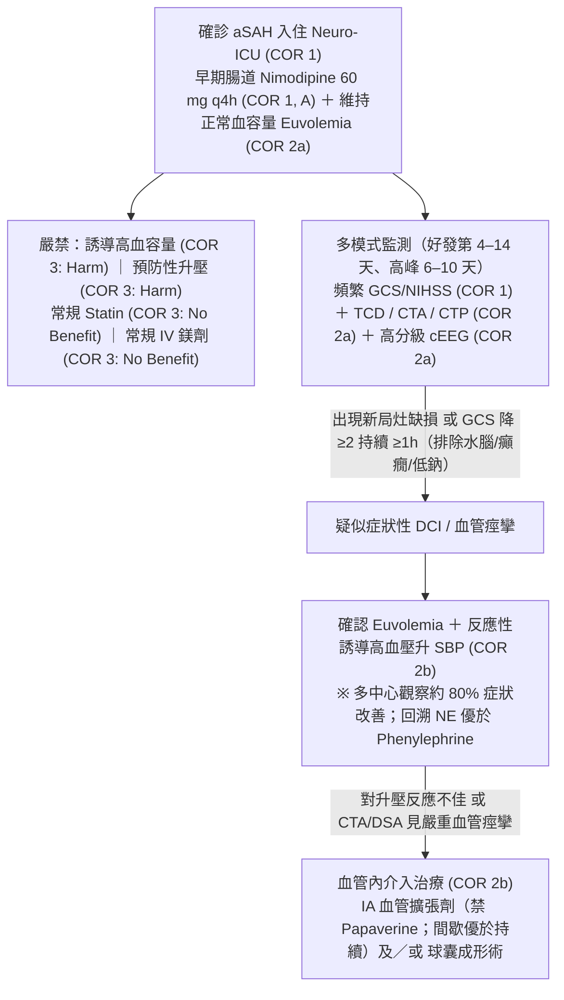

# 動脈瘤性蜘蛛膜下腔出血血管痙攣、遲發性腦缺血、水腦與重症處置

> [!tip] 臨床速查結論（Bottom Line，[[aha-asa-sah-2023|AHA/ASA aSAH (2023)]] Sec 8–10）
> - **DCI 預防兩大基石**：
>   1. **早期啟動腸道 [[nimodipine|Nimodipine]] `60 mg q4h`**（`COR 1, LOE A`；**中斷給藥顯著增加 DCI**，低血壓優先以常規內科支持維持足量）。
>   2. **目標導向維持正常血容量（Euvolemia）**（`COR 2a, B-R / B-NR`；CVP 單獨不可靠；利鈉低血鈉用 **Fludrocortisone** `COR 2a`）。
> - **DCI 監測與症狀性處置（好發第 4–14 天、高峰 6–10 天，~30%）**：頻繁 GCS/NIHSS（GCS 降 ≥2 持續 ≥1h 警訊，`COR 1`）、TCD（MCA ≥120 cm/s ＋ Lindegaard ≥3，敏感度 90%/NPV 92%，`2a`）、CTA/CTP（`2a`）、高分級 cEEG（`2a`）。出現症狀性 DCI 行**反應性誘導高血壓（`COR 2b`，~80% 改善）**，嚴重痙攣考慮 **IA 血管擴張劑（禁 Papaverine）及／或球囊成形術（`COR 2b`）**。
> - **DCI 四大紅線禁用**：**禁止誘導高血容量（`COR 3: Harm`）**、**禁止預防性血流動力增強（`COR 3: Harm`）**、**不建議常規 Statin（`COR 3: No Benefit, A`）**、**不建議常規 IV 鎂劑（`COR 3: No Benefit, A`）**。
> - **水腦處置（Sec 8.4）**：急性症狀性水腦緊急 **EVD 及／或腰椎引流（`COR 1`）**＋嚴守 **EVD 感染控制集束協議（`COR 1`）**；慢性水腦行永久分流（`COR 1`）；**禁常規終板造口術（`COR 3: No Benefit`）**。
> - **癲癇與 Phenytoin 紅旗（Sec 8.5）**：**禁止使用 Phenytoin（`COR 3: Harm`，改用 Levetiracetam）**；無 5 大高風險特徵（MCA 瘤／高分級／ICH／水腦／皮質梗塞）不給預防 ASM（`COR 3: No Benefit`）；初發癲癇療程 **`≤7 天`（`COR 2a`）**，**超過 7 天無益（`COR 3: No Benefit`）**。
> - **出院與長期追蹤（Sec 9–10）**：動脈瘤閉塞後啟 VTE 預防（`COR 1`）與早期復健（`COR 2a`）；無憂鬱禁 Fluoxetine（`COR 3`）；長期篩檢憂鬱／焦慮／性功能（`COR 1`）與 **MoCA 優於 MMSE（`COR 2a`）**；**圍手術期與長期腦血管影像追蹤殘餘／復發／新生動脈瘤（`COR 1`）**。

---

## 1. 血管痙攣與遲發性腦缺血（DCI）處置流程（Sec 8.2–8.3, Figure 3, e338–e343）

### 1.1 DCI 監測與治療對照表
| 類別與項目 | 具體建議內容與閾值 | COR / LOE | 關鍵數據與注意事項 |
| :--- | :--- | :--- | :--- |
| **腸道 [[nimodipine\|Nimodipine]]** | 早期啟動 **`60 mg q4h`**（每日 6 次）預防 DCI 並改善功能 | `COR 1, LOE A` | 16 試驗（N=3,361）；**中斷給藥顯著增 DCI**（ρ=0.431）；IV/IA 給藥證據不足 |
| **維持正常血容量（Euvolemia）** | 目標導向治療（GDT）維持正常血容量；低血鈉/利鈉用 **Fludrocortisone**（`COR 2a`） | `COR 2a, B-R / B-NR` | 低血容者 58% 發生 DCI；正常血容流程使 DCI 44.2%→7.7%（OR 0.10）；CVP 單獨不可靠 |
| **誘導高血容量 / 預防性升壓** | **禁止誘導高血容量**；**禁止預防性血流動力增強** | `COR 3: Harm, B-R` | 顯著增加心衰與肺部併發症，無益於預防 DCI |
| **監測工具：TCD / CTA / CTP / cEEG** | TCD（MCA **`≥120 cm/s`**＋**Lindegaard `≥3`**）；CTA/CTP；高分級 **cEEG**（`COR 2a`）或侵入 PbtO2/微透析（`COR 2b`） | `COR 2a` / `2b, B-NR` | TCD 敏感度 **90%**、NPV **92%**；CTA 中心痙攣敏感度 **91%**；cEEG 預警陽性率 **96.2%**（提前中位 **1.9 天**） |
| **症狀性 DCI → 誘導高血壓** | 出現症狀性痙攣／DCI 時升高收縮壓 | `COR 2b, B-NR` | 觀察約 **80%** 改善；回溯 Norepinephrine 94% vs Phenylephrine 71%（p=0.01）；HIMALAIA RCT 收案不足中止 |
| **嚴重痙攣 → IA 血管擴張劑／成形術** | 動脈內血管擴張劑（`2b`）及／或腦血管球囊成形術（`2b`） | `COR 2b, B-NR` | **避免 Papaverine（神經毒性）**；間歇推注優於持續；球囊成形耐久但慎防破裂 |
| **常規 Statin / IV 鎂劑** | **均不建議常規使用** | `COR 3: No Benefit, A` | 6 RCT Statin 無 DCI/死亡益處反恐增菌血症；IV 鎂無梗塞/死亡益處 |

---

## 2. 水腦、癲癇與 ICU 重症併發症處置（Sec 8, 8.1, 8.4, 8.5）

| 併發症領域 | 具體建議內容 | COR / LOE | 關鍵數據與紅線 |
| :--- | :--- | :--- | :--- |
| **急性症狀性水腦（15%–87%）** | 緊急腦脊髓液引流（**EVD 及／或腰椎引流**）改善神經預後（轉送前視需要先行置放） | `COR 1, B-NR` | 腰椎引流顯示可降 DCI 與改善早期預後 |
| **EVD 感染控制集束協議（Table 4）** | 嚴格執行含無菌技術、**抗生素塗層導管**、減少 CSF 抽樣、標準敷料與拔管訓練之集束協議 | `COR 1, B-NR` | 腦室炎感染率自 6.1%–37% 降至 **0%–9%** |
| **慢性症狀性水腦（8.9%–48%）** | 永久性 CSF 分流（Shunt，`COR 1`）；**常規終板造口術無益（`COR 3: No Benefit, C-LD`）** | `COR 1` / `3` | 終板造口術統合（N=1,973）10% vs 14%（RR 0.88 NS） |
| **癲癇監測與預防分層** | 具 **5 大高風險特徵**（MCA 瘤、高分級 HH >3 / Fisher III–IV、ICH、水腦、皮質梗塞）或意識波動：做 **cEEG（24–48h）**（`COR 2a`）並可考慮短期預防 ASM（`COR 2b`）；**無高風險者不給預防 ASM（`COR 3: No Benefit, B-R`）** | `COR 2a` / `2b` / `3` | EEG 確診率 7.8%–15.2%；栓塞遲發癲癇低於夾閉 |
| **禁止使用 Phenytoin** | **Phenytoin 用於癲癇預防與發病率及死亡率上升相關（Harm）** | `COR 3: Harm, B-NR` | 損認知、可能與 [[nimodipine\|Nimodipine]] 代謝競爭；改用 **Levetiracetam** |
| **初發發作癲癇（Onset Seizures）療程** | 給予 ASM **`≤7 天`**（`COR 2a, B-NR`）；無既有癲癇者 **超過 7 天無益（`COR 3: No Benefit, B-NR`）** | `COR 2a` / `3` | 非初發之術後早期/晚期癲癇（>1 週）則需專科較長期管理 |
| **呼吸器、ARDS、VTE、血糖與護理** | 呼吸器 >24h 採 ICU 集束（`COR 1`）；重度 ARDS 於 **ICP 監測下**俯臥/肺復張（`2b`）；**動脈瘤閉塞後**啟 VTE 預防（`COR 1`，併用 DAPT 慎防 ICH）；控糖避低血糖（`2a`）；難治發燒 TTM 效用未明（`2b`）；經口前必做吞嚥篩檢（`COR 1`） | `COR 1` / `2a` / `2b` | 動脈瘤未閉塞前臥床；閉塞後早期實證下床（`2a`），DCI 升壓期暫停 |

---

## 3. 復健、長期認知／情緒與動脈瘤復發追蹤（Sec 9–10, Table 5, e346–e351）
- **出院前與亞急性篩檢（`COR 1, B-NR`）**：評估身體、認知、行為與 QOL；常規篩檢憂鬱/焦慮（HADS/GAD-7/PHQ-9）與認知障礙；憂鬱給予心理與藥物治療（SSRI RR 0.75）；無憂鬱者**禁用 Fluoxetine 20 mg 促恢復（`COR 3: No Benefit, A`，增骨鬆/骨折/癲癇）**。
- **長期追蹤重點（Sec 9.2）**：篩檢並介入憂鬱、焦慮與**性功能障礙（IIEF/FSFI，`COR 1`）**；認知篩檢**優先選 MoCA 勝過 MMSE（`COR 2a`）**；衛教長期失智風險（30 年世代 **HR 2.72**，中位診斷 74 歲，早於 ICH 79 歲與 AIS 81 歲；`COR 2b`）。
- **動脈瘤影像追蹤（Sec 10，`COR 1, B-NR`）**：
  - **圍手術期血管影像**：偵測殘餘或早期復發（ISAT 30d 再出血 1.9% 栓塞 vs 0.6% 夾閉，主因不完全閉塞）。
  - **長期追蹤血管影像**：監測復發再生長（夾閉有殘餘 **2.1%/年** vs 無殘餘 **0.26%/年**）、其他既有動脈瘤變化或**新生動脈瘤**（高風險：年輕、家族史 ≥2 一等親、多發動脈瘤）。

---

## 4. 各大指引建議對照（AHA/ASA vs ESO vs 台灣相關指引）

| 比較面向 | [[aha-asa-sah-2023\|AHA/ASA aSAH 指引（2023）]] | ESO 指引 | 台灣相關指引 | 備註 |
| :--- | :--- | :--- | :--- | :--- |
| **腸道 Nimodipine** | 早期啟動 `60 mg q4h`（`COR 1, LOE A`） | `[庫內文獻尚未收錄]` | `[庫內文獻尚未收錄]` | 待收錄 ESO 與台灣 SAH 指引補齊對照 |
| **高血容量與預防性升壓** | 均列 **`COR 3: Harm, LOE B-R`**（全面轉向 Euvolemia） | `[庫內文獻尚未收錄]` | `[庫內文獻尚未收錄]` | — |
| **Phenytoin 預防癲癇** | **`COR 3: Harm, LOE B-NR`**（改用 Levetiracetam） | `[庫內文獻尚未收錄]` | `[庫內文獻尚未收錄]` | — |

---

## 5. 相關頁面
- **藥物快查**：[[nimodipine|Nimodipine（尼莫地平）]]
- **姊妹主題**：[[sah-diagnosis-aneurysm-securing|動脈瘤性蜘蛛膜下腔出血診斷、再出血預防與動脈瘤處置]]
- **核心指引**：[[aha-asa-sah-2023|AHA/ASA 動脈瘤性蜘蛛膜下腔出血臨床指引 (2023)]]
- **上游導覽**：[[overview|腦中風臨床處置總覽]]
